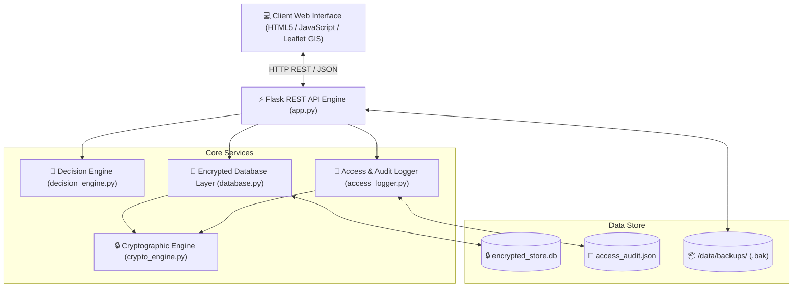

# 🛡️ The Allocator — Emergency Resource Management & Decision-Support System

**The Allocator** is an enterprise-grade Emergency Resource Allocation, Dispatch, and Decision-Support Platform designed for emergency response teams, disaster management agencies, and critical infrastructure operators. 

The platform leverages intelligent multi-criteria scoring algorithms, AES-256 encrypted data storage, fine-grained Role-Based Access Control (RBAC), real-time GIS spatial mapping, crisis scenario simulations, and HMAC-verified tamper-evident backups to guarantee rapid and secure emergency payload deployment.

---

## 📐 System Architecture Overview

The system is built on a modular Python/Flask backend and an interactive dynamic web interface. The core engine is decoupled into distinct modules for security, data management, audit logging, and decision mathematics.



### Module Directory Breakdown

```
resource_allocator/
├── app.py                      # Flask Server, RESTful endpoints & Session Auth
├── README.md                   # System documentation & usage guide
├── core/
│   ├── __init__.py
│   ├── crypto_engine.py        # Fernet AES-256 & PBKDF2 key derivation & HMAC verification
│   ├── database.py             # Encrypted JSON data storage engine & seed initialisation
│   ├── decision_engine.py      # Haversine distance, composite scoring & simulation engine
│   └── access_logger.py        # Audit logging engine & filtering
├── data/                       # Local data storage (Keys, Stores, Audit & Backups)
│   ├── .master_key.key
│   ├── .master_salt.salt
│   ├── encrypted_store.db
│   ├── access_audit.json
│   └── backups/
├── static/                     # Web UI static assets
│   ├── css/
│   │   └── style.css           # Glassmorphism dark-theme CSS layout
│   └── js/
│       ├── app.js              # Tab navigation, CRUD UI logic, RBAC switcher
│       ├── map.js              # Leaflet GIS map rendering & geographic overlays
│       └── recommendation.js   # Decision support modal & dispatch execution UI
├── templates/
│   └── index.html              # Main Command Center UI template
└── tests/
    └── test_core.py            # Automated PyUnit test suite (100% pass)
```

---

## ✨ Key Features & Capabilities

### 1. 🧠 Intelligent Decision-Support & Recommendation Engine
- **Composite Resource Scoring**: Evaluates resource deployment using a weighted scoring formula:
  $$\text{Score} = (\text{Usable Stock} \times 10) - (\text{Distance (km)} \times 2) - (\text{ETA (min)} \times 0.5) + (\text{Category Priority Weight} \times 50)$$
- **Geographic Distance & Transit ETA**: Uses the **Haversine formula** to calculate true spherical distance (in km) between depots and incident sites. Estimates travel time based on transport mode heuristics (`air` @ 220 km/h, `express` @ 80 km/h, `road` @ 50 km/h, `water` @ 35 km/h).
- **Reserve Threshold Enforcement & Overrides**: Respects minimum stock safety buffers during standard operations, while allowing emergency reserve overrides during `CRITICAL` severity incidents.
- **Deficit Detection & Inter-Agency Rationales**: Highlights supply shortfalls and provides actionable recommendations to dispatch commanders.

### 2. 🔒 Encrypted Resource Vault (AES-256 & Cryptography)
- **Field-Level Encryption at Rest**: Sensitive details such as vault locker codes, access PINs, high-pressure specs, and transport security credentials are encrypted using **Fernet AES-256**.
- **Cryptographic Key Derivation**: Uses **PBKDF2-HMAC-SHA256** with 100,000 iterations to derive master keys securely.
- **Decryption RBAC Control**: Decrypted secrets are only revealed to authorized roles (`Admin`, `Dispatcher`) upon explicit API request.

### 3. 👥 Role-Based Access Control (RBAC)
Supports 3 operational user roles with progressive access privileges:

| Privilege / Action | Admin (Commander) | Dispatcher (Ops) | Field Officer |
| :--- | :---: | :---: | :---: |
| **View Incident Map & Basic Vault** | ✅ | ✅ | ✅ |
| **Decrypt Sensitive Specs & Codes** | ✅ | ✅ | ❌ |
| **Declare New Incidents** | ✅ | ✅ | ❌ |
| **Approve & Deploy Dispatches** | ✅ | ✅ | ❌ |
| **Manage Resource Categories** | ✅ | ✅ | ❌ |
| **Delete Categories / Edit Core Vault** | ✅ | ❌ | ❌ |
| **View Security Audit Logs** | ✅ | ✅ | ❌ |
| **Export Audit Logs (JSON)** | ✅ | ❌ | ❌ |
| **Create & Restore Database Backups** | ✅ | ❌ | ❌ |

### 4. 🗺️ Real-Time GIS Incident Command Map
- Powered by **Leaflet GIS**, presenting spatial visualizations of active incidents, emergency depots, transit radii, and severity markers.
- Incident Declaration interface allowing dispatchers to log GPS coordinates, affected population counts, severity classification (`CRITICAL`, `HIGH`, `MODERATE`), and specific resource requirements.

### 5. 🔮 Crisis Scenario Simulation Engine
- Simulates large-scale disaster scenarios (**Earthquake**, **Flood**, **Wildfire**, **Epidemic**) with adjustable severity multipliers (1.0x - 3.0x).
- Calculates an **Overall Preparedness Index (%)**, category-by-category stock shortfall analysis, and mitigation recommendations.

### 6. 🔄 Proactive Stock Rebalancing
- Automatically detects surplus inventory in low-risk sectors and recommends stock transfers to depots in high-risk zones currently experiencing active disaster activity.

### 7. 📜 Security Audit Logging
- Audits every system transaction (logins, failed authentication, decryption requests, category edits, dispatch deployments, backup creations/restores).
- Real-time filtering by user role and action type, with raw export functionality for compliance officers.

### 8. 📦 HMAC-Verified Backup & Disaster Recovery
- Encrypts complete system snapshots using Fernet AES-256.
- Generates **HMAC-SHA256 digital signatures** for backup files to detect payload tampering or data corruption prior to system restoration.

---

## 📡 RESTful API Reference

### Authentication (`/api/auth`)
- `POST /api/auth/login` — Authenticates user credentials & sets session cookie.
- `POST /api/auth/logout` — Clears active user session.
- `GET /api/auth/me` — Returns current logged-in user profile & role.

### Resource Vault & Categories (`/api/resources`, `/api/categories`)
- `GET /api/resources?decrypt=true|false` — Fetches resources (decryption restricted by RBAC).
- `POST /api/resources` — Adds a new resource item with encrypted specifications.
- `GET /api/categories` — Fetches all resource categories and priority weights.
- `POST /api/categories` — Creates a new resource category.
- `PUT /api/categories/<cat_id>` — Updates category properties.
- `DELETE /api/categories/<cat_id>` — Deletes a category (Admin only).

### Incidents & Decision Support (`/api/incidents`, `/api/recommendations`)
- `GET /api/incidents` — Retrieves active crisis incidents and depot locations.
- `POST /api/incidents` — Declares a new crisis incident.
- `GET /api/recommendations/<incident_id>` — Computes optimal dispatch plan and readiness impact score.
- `POST /api/recommendations/approve` — Executes and logs emergency resource dispatch payload.

### Simulation & Rebalancing (`/api/simulate`, `/api/rebalance`)
- `POST /api/simulate` — Runs disaster stress-test simulation with severity multipliers.
- `GET /api/rebalance` — Obtains proactive stock rebalancing suggestions.

### Audit & Backups (`/api/logs`, `/api/backups`)
- `GET /api/logs?role=<role>&action=<action>` — Queries security audit logs.
- `GET /api/logs/export` — Downloads raw audit log JSON file (Admin only).
- `POST /api/backups/create` — Generates Fernet-encrypted snapshot with HMAC signature.
- `GET /api/backups` — Lists all snapshot backups.
- `GET /api/backups/download/<filename>` — Downloads backup `.bak` file.
- `POST /api/backups/restore` — Restores database state after verifying HMAC signature integrity.

---

## 🚀 Quick Start Guide

### Prerequisites
- Python 3.9+
- Flask & Cryptography packages

### 1. Installation
Clone the repository and install the required dependencies:
```bash
pip install flask cryptography
```

### 2. Run the Application
Start the Flask application server:
```bash
python app.py
```
The system command center will be accessible at `http://127.0.0.1:5000`.

### 3. Default Demo User Accounts

| Username | Password | Role | Description |
| :--- | :--- | :--- | :--- |
| `admin` | `admin123` | **Admin** | Full system command, backup access & raw exports |
| `dispatcher` | `dispatcher123` | **Dispatcher** | Incident management, decision support & dispatches |
| `field` | `field123` | **Field Officer** | Read-only access to GIS map & basic inventory lists |

---

## 🧪 Automated Testing

The repository includes a comprehensive unit test suite covering cryptography, audit logging, role-based resource access, composite scoring calculations, and scenario simulation routines.

Run the test suite using standard Python `unittest`:
```bash
python -m unittest tests/test_core.py
```

Expected output:
```text
.....
----------------------------------------------------------------------
Ran 5 tests in 0.98s

OK
```

---

## 📄 License
Internal Emergency Operations & Crisis Response System. All rights reserved.
